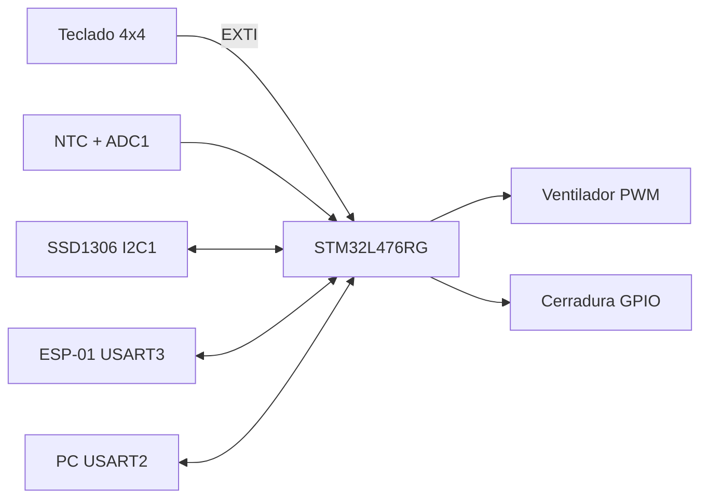

# Room Control — Firmware STM32L476RG

Firmware de control de acceso y climatización para una sala: cerradura accionada por
contraseña, ventilador regulado por temperatura y telemetría remota por ESP-01.

| Elemento | Detalle |
| --- | --- |
| MCU | STM32L476RGT6, Cortex-M4F a 80 MHz |
| Placa | NUCLEO-L476RG |
| Sensado | NTC 10 kΩ (β = 3200 K) sobre ADC1_IN5 |
| Interfaz local | Teclado matricial 4×4 + OLED SSD1306 128×64 (I²C) |
| Actuadores | Cerradura (GPIO) y ventilador 12 V (PWM + DMA) |
| Conectividad | ESP-01 por USART3, 115200 8N1 |
| Depuración | USART2 (ST-Link VCP) a 115200 8N1 |
| Build | CMake + `arm-none-eabi-gcc` + Ninja |

## Funcionalidad

- Máquina de estados de acceso: `LOCKED → INPUT_PASSWORD → UNLOCKED / ACCESS_DENIED`.
- Contraseña de 4 dígitos, por defecto `1111`, modificable por comando remoto.
- Control automático del ventilador en cuatro niveles (0 %, 30 %, 70 %, 100 %) con
  rampas suaves generadas por DMA, más anulación remota temporal.
- Pantalla OLED con estado, máscara de contraseña, temperatura y porcentaje del ventilador.
- Protocolo de línea sobre UART para consultar temperatura, consultar estado, forzar
  el ventilador y cambiar la contraseña.
- Trama periódica de telemetría cada 500 ms para el dashboard Node-RED.

## Arquitectura en una vista



El detalle de módulos, contexto de ejecución y temporización está en
[`docs/arquitectura.md`](docs/arquitectura.md). El pinout y la configuración de
periféricos, en [`docs/hardware.md`](docs/hardware.md). El protocolo serie exacto,
en [`docs/protocolo.md`](docs/protocolo.md).

## Estructura del repositorio

```text
.
├── Core/                        Código generado por STM32CubeMX
│   ├── Inc/                     main.h, configuración HAL, cabeceras de interrupciones
│   └── Src/                     main.c, interrupciones, MSP y arranque del sistema
├── App/                         Lógica de aplicación (independiente de CubeMX)
│   ├── Inc/room_control.h
│   └── Src/room_control.c       Máquina de estados, contraseña y política del ventilador
├── Drivers/
│   ├── CMSIS/                   CMSIS (vendor)
│   ├── STM32L4xx_HAL_Driver/    HAL STM32L4 (vendor)
│   ├── led/                     LED genérico por GPIO
│   ├── keypad/                  Escaneo del teclado matricial 4×4
│   ├── ntc/                     Lectura y linealización del termistor NTC
│   ├── ring_buffer/             Cola de bytes de un productor / un consumidor
│   └── ssd1306/                 Driver OLED SSD1306 (I²C)
├── cmake/                       Toolchains GCC y clang y fuentes generadas por CubeMX
├── docs/                        Documentación del sistema e informe original
├── CMakeLists.txt               Build principal
├── CMakePresets.json            Presets Debug / Release / MinSizeRel / RelWithDebInfo
├── Room_Control_Final_2025_2.ioc Proyecto STM32CubeMX
├── STM32L476RGTx_FLASH.ld       Script de enlazado (GCC)
├── STM32L476XX_FLASH.ld         Script de enlazado (toolchain clang)
└── startup_stm32l476xx.s        Vector de arranque y `Reset_Handler`
```

`Core/` se reserva para lo que STM32CubeMX regenera. La lógica propia vive en `App/`
y los drivers en `Drivers/`, de modo que regenerar el proyecto no sobrescribe código
de aplicación.

## Compilación

Dependencias en Ubuntu:

```bash
sudo apt install cmake ninja-build gcc-arm-none-eabi
```

Configurar y compilar:

```bash
cmake --preset Debug
cmake --build --preset Debug
```

El artefacto es `build/Debug/Room_Control_Final_2025_2.elf`. Para obtener binario o
hexadecimal:

```bash
arm-none-eabi-objcopy -O binary build/Debug/Room_Control_Final_2025_2.elf firmware.bin
arm-none-eabi-objcopy -O ihex   build/Debug/Room_Control_Final_2025_2.elf firmware.hex
```

## Flasheo

Con STM32CubeProgrammer:

```bash
STM32_Programmer_CLI -c port=SWD -w build/Debug/Room_Control_Final_2025_2.elf -rst
```

Con OpenOCD:

```bash
openocd -f interface/stlink.cfg -f target/stm32l4x.cfg \
        -c "program build/Debug/Room_Control_Final_2025_2.elf verify reset exit"
```

## Operación

1. Al energizar, la OLED muestra `Bienvenido!` durante 1 s y el sistema queda `BLOQUEADO`.
2. La primera tecla inicia el ingreso de la contraseña; `*` cancela mientras se escribe.
3. Con la contraseña correcta la puerta se desbloquea; `*` vuelve a bloquear.
4. El ventilador sigue la temperatura: por debajo de 25 °C está apagado, hasta 30 °C al
   30 %, hasta 40 °C al 70 % y por encima al 100 %.
5. El dashboard recibe `T=…;STATE=…;FAN=…` cada 500 ms.

## Demostración

Video de funcionamiento del sistema y del dashboard en Node-RED:

[Ver demostración en YouTube](https://youtu.be/DbfoEAb-rX4?si=t2fPlXAObiiwzrSR)

## Documentación

| Documento | Contenido |
| --- | --- |
| [`docs/arquitectura.md`](docs/arquitectura.md) | Módulos, contextos de ejecución, máquina de estados y deuda técnica |
| [`docs/hardware.md`](docs/hardware.md) | Pinout, relojes, periféricos y notas eléctricas |
| [`docs/protocolo.md`](docs/protocolo.md) | Comandos, respuestas y trama de telemetría |
| [`docs/informe.md`](docs/informe.md) | Informe original del curso (documento histórico) |

## Autores

Juan David Villota y Sebastián Tovar — Ingeniería Electrónica, Universidad Nacional de Colombia.
