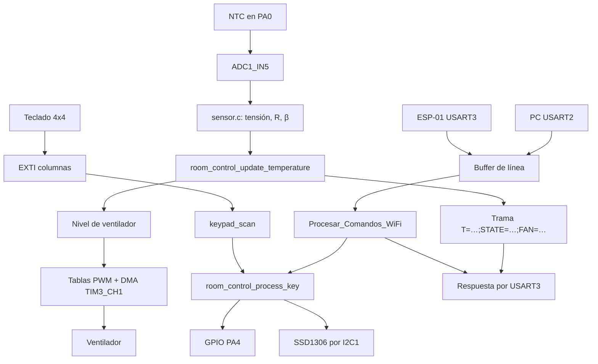
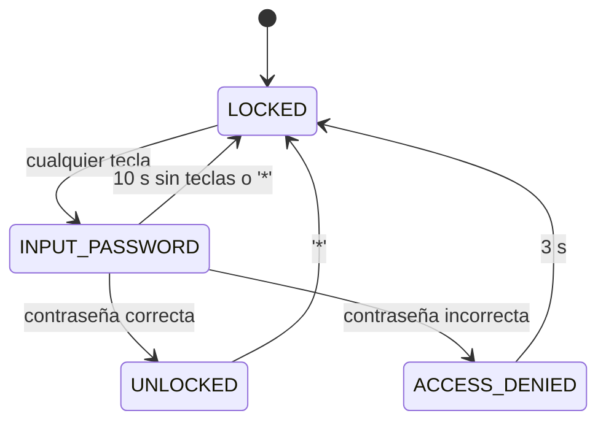

# Arquitectura del firmware

Este documento describe cómo está organizado el firmware **tal como está hoy**.
No describe una refactorización pendiente: cuando menciona problemas, lo hace para
dejar constancia de la deuda técnica, no para afirmar que ya fueron corregidos.

## 1. Principios de organización

El repositorio separa tres capas con distinta tasa de cambio:

| Capa | Directorio | Se regenera con CubeMX | Contenido |
| --- | --- | --- | --- |
| Generada | `Core/` | Sí | Arranque, relojes, MSP, interrupciones y `main.c` |
| Aplicación | `App/` | No | Máquina de estados, contraseña y política del ventilador |
| Drivers | `Drivers/` | No (salvo HAL/CMSIS) | Periféricos y utilidades |

La regla práctica es que **todo el código propio de aplicación vive fuera de `Core/`**.
Así, volver a generar el proyecto desde `Room_Control_Final_2025_2.ioc` no sobrescribe
la lógica del sistema. Los archivos de `Core/` que contienen código de usuario lo
hacen dentro de bloques `/* USER CODE BEGIN … */`, que CubeMX preserva.

## 2. Módulos

| Módulo | Archivos | Responsabilidad |
| --- | --- | --- |
| Arranque | `Core/Src/main.c` | Inicialización de HAL y periféricos, bucle principal, callbacks de interrupción y retarget de `printf` a USART2 |
| Interrupciones | `Core/Src/stm32l4xx_it.c` | Handlers de USART2/3, EXTI y DMA1_Channel6; delegan en la HAL |
| Inicialización MSP | `Core/Src/stm32l4xx_hal_msp.c` | Relojes y GPIO de cada periférico, configuración del DMA de TIM3 |
| Control de sala | `App/Src/room_control.c`, `App/Inc/room_control.h` | Máquina de estados, contraseña, puerta, política y rampas del ventilador, contenido de la OLED |
| Sensor NTC | `Drivers/ntc/sensor.c` | Calibración del ADC, conversión ADC → tensión → resistencia → temperatura |
| Teclado | `Drivers/keypad/keypad.c` | Escaneo por filas del teclado 4×4 y mapa de teclas |
| OLED | `Drivers/ssd1306/ssd1306.c` | Driver SSD1306 por I²C y fuentes |
| LED | `Drivers/led/led.c` | Encendido, apagado y conmutación de un GPIO |
| Cola de bytes | `Drivers/ring_buffer/ring_buffer.c` | Cola circular de un productor / un consumidor. Inicializada en `main.c` pero **sin uso actual** |

## 3. Contextos de ejecución

### 3.1 Bucle principal

`main()` inicializa HAL, reloj a 80 MHz, GPIO, DMA, USART2, I2C1, TIM3, ADC1 y USART3.
Después ejecuta una pantalla de bienvenida de 1 s, calcula las tablas de PWM y entra en
un bucle no bloqueante en intención, con este orden:

| Paso | Acción | Periodicidad real |
| --- | --- | --- |
| 1 | `heartbeat()` conmuta el LED LD2 | 500 ms |
| 2 | `Procesar_Comandos_WiFi()` si `cmd_wifi_ready` | Al completar una línea |
| 3 | `room_control_update()`: lee ADC, aplica puerta, ventilador y redibuja OLED | Cada iteración |
| 4 | `keypad_scan()` si `keypad_interrupt_pin != 0` | Por interrupción EXTI |
| 5 | `Send_Dashboard_Frame()` | 500 ms |
| 6 | Demo: B1 y byte de USART2 escriben en la OLED | Por evento |

La iteración está dominada por el redibujado completo de la OLED: `ssd1306_UpdateScreen()`
transfiere 1024 bytes de imagen más comandos de página en 32 transacciones I²C. Con I²C a
100 kHz eso ronda **100 ms por trama**, así que en la práctica el lazo tarda ~100 ms y la
latencia de un comando UART puede llegar a ese orden. El ADC se lee con
`HAL_ADC_PollForConversion(..., HAL_MAX_DELAY)`, es decir, también de forma bloqueante.

### 3.2 Interrupciones

Prioridades según `NVIC_PRIORITYGROUP_4` (4 bits de preferencia):

| IRQ | Prioridad | Origen | Acción |
| --- | --- | --- | --- |
| `USART2_IRQn` | 0 | Byte recibido del PC | Acumula en `rx3_buffer` y marca `cmd_wifi_ready` |
| `USART3_IRQn` | 0 | Byte recibido del ESP-01 | Acumula en `rx3_buffer` y marca `cmd_wifi_ready` |
| `DMA1_Channel6_IRQn` | 2 | Fin de transferencia de TIM3_CH1 | `HAL_TIM_PWM_PulseFinishedCallback` pone `finish_pwm = 0` |
| `EXTI9_5_IRQn` | 3 | Columnas C2, C3, C4 | `HAL_GPIO_EXTI_Callback` guarda el pin en `keypad_interrupt_pin` |
| `EXTI15_10_IRQn` | 3 | Columna C1 y botón B1 | Igual que el anterior, o marca `button_pressed` |

Los dos puertos UART comparten el mismo buffer de recepción y la misma bandera. Es una
limitación de diseño conocida (ver §6), no un comportamiento intencional.

## 4. Flujo de datos

## 5. Máquina de estados

| Estado | Comportamiento | Salidas |
| --- | --- | --- |
| `ROOM_STATE_LOCKED` | Puerta cerrada; el ventilador sigue la temperatura | Cualquier tecla inicia `INPUT_PASSWORD` y ocupa el primer dígito |
| `ROOM_STATE_INPUT_PASSWORD` | Acumula hasta 4 caracteres y compara con `room->password` | `UNLOCKED`, `ACCESS_DENIED` o `LOCKED` por timeout |
| `ROOM_STATE_UNLOCKED` | `DOOR_STATUS` en alto; la OLED muestra temperatura y PWM | `*` vuelve a `LOCKED` |
| `ROOM_STATE_ACCESS_DENIED` | Muestra el mensaje y envía `ACCESO DENEGADO` una vez por USART2 y USART3 | Vuelve a `LOCKED` a los 3 s |
| `ROOM_STATE_EMERGENCY` | Definido en el enum, sin transiciones ni uso | — |

Detalles relevantes:

- La contraseña por defecto es `1111` (`DEFAULT_PASSWORD` en `room_control.c`).
- En `LOCKED` **no se valida que la tecla sea numérica**: cualquier carácter entra al
  buffer y consume una posición.
- `last_input_time` se actualiza con cada tecla, incluidas las no numéricas.
- El comando remoto `SET_PASS:XXXX` cambia la contraseña solo si `XXXX` tiene exactamente
  cuatro caracteres; no valida que sean dígitos.

## 6. Control del ventilador

El ventilador se conecta a `TIM3_CH1` (PA6). TIM3 está configurado con
`PSC = 799` y `ARR = 999` sobre un reloj de 80 MHz, es decir:

- frecuencia de PWM: 80 MHz / 800 / 1000 = **100 Hz**;
- resolución: 1000 cuentas por periodo (1 cuenta = 0,1 %).

El duty se actualiza por DMA desde una tabla: una entrada por periodo de PWM. Las tablas
se generan en `calculate_pwm_tables()` con un escalón de 5 cuentas entre entradas y dos
entradas por cada 1 %, lo que da una pendiente de **50 % por segundo** y un recorrido
completo 0 → 100 % en unos 2 s.

| Tabla | Entradas | Tramo |
| --- | --- | --- |
| `pwm_0` | 1 | 0 % |
| `pwm_0_30` | 60 | 0 → 30 % |
| `pwm_30_0` | 60 | 30 → 0 % |
| `pwm_30_70` | 80 | 30 → 70 % |
| `pwm_70_30` | 80 | 70 → 30 % |
| `pwm_70_100` | 60 | 70 → 100 % |
| `pwm_100_70` | 60 | 100 → 70 % |

La variable global `state` (0 a 3) recuerda el nivel aplicado y `finish_pwm` indica si hay
una transferencia DMA en curso. El callback de DMA pone `finish_pwm = 0` y la lógica
automática decide la siguiente rampa.

Niveles automáticos:

| Temperatura | Nivel | Duty |
| --- | --- | --- |
| ≤ 25 °C | `FAN_LEVEL_OFF` | 0 % |
| 25 °C < T < 30 °C | `FAN_LEVEL_LOW` | 30 % |
| 30 °C ≤ T < 40 °C | `FAN_LEVEL_MED` | 70 % |
| T ≥ 40 °C | `FAN_LEVEL_HIGH` | 100 % |

La comparación usa la temperatura convertida a entero (`uint32_t level = current_temperature`),
por lo que 29,9 °C se evalúa como 29 °C.

El comando `FORCE_FAN:N` llama a `room_control_force_fan_level()`, que inicia la rampa
correspondiente, pone `finish_pwm = 1`, activa `fan_force` y guarda `star_force_time`.
La intención es mantener el nivel forzado 5 s y luego volver al automático.

## 7. Pantalla OLED

`room_control_update_display()` borra el framebuffer, dibuja según el estado y llama a
`ssd1306_UpdateScreen()` en cada invocación. Contenido actual:

| Estado | Líneas |
| --- | --- |
| `LOCKED` | `SISTEMA` / `BLOQUEADO` |
| `INPUT_PASSWORD` | `CLAVE: *` … `CLAVE: ****` (un `case` por longitud) |
| `UNLOCKED` | `ACCESO OK` / `Temp: %d.%dC` / `Fan: %d%%` |
| `ACCESS_DENIED` | `ACCESO` / `DENEGADO` y envío único de `ACCESO DENEGADO` por UART |

La cadena de temperatura usa `(int)(temperatura * 100) % 100` como parte decimal, así que
no conserva el cero inicial ni funciona con valores negativos.

## 8. Compilación

`CMakeLists.txt` declara las fuentes de usuario y los directorios de inclusión; el resto
lo aporta `cmake/stm32cubemx/CMakeLists.txt`, generado por CubeMX. El enlazado usa
`STM32L476RGTx_FLASH.ld` y `--specs=nano.specs`; el toolchain de clang usa
`STM32L476XX_FLASH.ld`.

Presets disponibles: `Debug`, `RelWithDebInfo`, `Release`, `MinSizeRel`.
`Debug` compila con `-O0 -g3`; `Release`, con `-Os -g0`.

## 9. Problemas conocidos y deuda técnica

Ordenados por impacto. Las líneas corresponden al código actual.

| # | Severidad | Problema | Ubicación |
| --- | --- | --- | --- |
| 1 | Alta | La comparación `star_force_time - start_fan_time > 5000` se evalúa sobre `uint32_t` y se desborda: el override remoto se cancela en la iteración siguiente en vez de durar 5 s | `App/Src/room_control.c:340-346` |
| 2 | Alta | USART2 y USART3 comparten `rx3_buffer`, `rx3_index`/`usart2_index` y `cmd_wifi_ready`; una línea del PC puede corromper un comando del ESP-01, y toda respuesta sale por USART3 | `Core/Src/main.c:95-97`, `156-207`, `209-296` |
| 3 | Alta | Las transiciones de PWM pueden saltar de nivel: desde 70 % o 100 % hacia OFF se arranca siempre `pwm_30_0` (salto a 30 %), y desde 100 % hacia LOW se arranca `pwm_70_30` (salto a 70 %) | `App/Src/room_control.c:349-381` |
| 4 | Alta | `room_control_force_fan_level()` pone `finish_pwm = 1`; el callback de DMA lo baja a 0 y la lógica automática retoma de inmediato, por lo que el forzado no se sostiene | `App/Src/room_control.c:175-197` |
| 5 | Media | `display_update_needed` se escribe pero nunca se lee; la OLED se redibuja completa en cada iteración (~100 ms de I²C a 100 kHz) | `App/Src/room_control.c:75`, `106`, `249-320` |
| 6 | Media | El formato de temperatura trunca la parte decimal (`(int)(t*100)%100`) y las respuestas `GET_TEMP`/`GET_STATUS` no usan `%02d`: 25,05 °C se responde como `25.5`; con temperaturas negativas el formato es incorrecto. La trama del dashboard sí usa `%02d`, pero comparte la truncación | `App/Src/room_control.c:294`, `298`; `Core/Src/main.c:227`, `246`, `311` |
| 7 | Media | `sensor.c` no valida el resultado: divide por `voltage` y aplica `logf` sin comprobar los límites; usa `HAL_MAX_DELAY`, que puede colgar el lazo si el ADC no termina | `Drivers/ntc/sensor.c:8-18` |
| 8 | Media | `keypad_scan()` espera la liberación de la tecla con un `while`, bloqueando el lazo mientras se mantiene presionada | `Drivers/keypad/keypad.c:55-57` |
| 9 | Media | `keypad_init()` deja las cuatro filas en bajo (activas); con dos teclas simultáneas se cortocircuitan filas | `Drivers/keypad/keypad.c:16-20` |
| 10 | Baja | Escrituras duplicadas del pin `DOOR_STATUS` en cada rama | `App/Src/room_control.c:325-331` |
| 11 | Baja | Código de demostración activo: B1 y cada byte recibido por USART2 escriben en la OLED | `Core/Src/main.c:419-429` |
| 12 | Baja | Campos y variables muertos o desincronizados: `manual_fan_override` nunca se activa, `fan_state` no se usa, `display_update_needed` no se lee, `state` y `finish_pwm` son globales compartidos entre ISR y bucle principal | `App/Src/room_control.c:34`, `42`, `46`, `58` |
| 13 | Baja | Contraseña por defecto `1111` en claro y sin límite de intentos | `App/Src/room_control.c:10` |
| 14 | Baja | El parser usa `strstr`, así que acepta el comando en cualquier posición de la línea; `FORCE_FAN` con nivel fuera de 0–3 responde `OK` sin ejecutar nada | `Core/Src/main.c:222-289` |
| 15 | Baja | `ring_buffer` se inicializa pero no se usa en ninguna ruta | `Core/Src/main.c:99-100`, `376` |

## 10. Líneas de evolución sugeridas

Sin cambiar el protocolo externo ni el hardware, el orden de menor a mayor riesgo sería:

1. Separar la lógica pura (máquina de estados, política de temperatura, parser de
   comandos) de la HAL para poder probarla en host.
2. Un buffer de línea por puerto UART y una cola ISR → bucle principal.
3. Escaneo de teclado no bloqueante, con antirrebote por tiempo.
4. Un solo origen de verdad para el nivel del ventilador y una rampa genérica que parta
   del duty actual.
5. Redibujar la OLED solo cuando cambie el contenido, con una tasa máxima fija.

Cada punto tiene su justificación en la tabla anterior.
